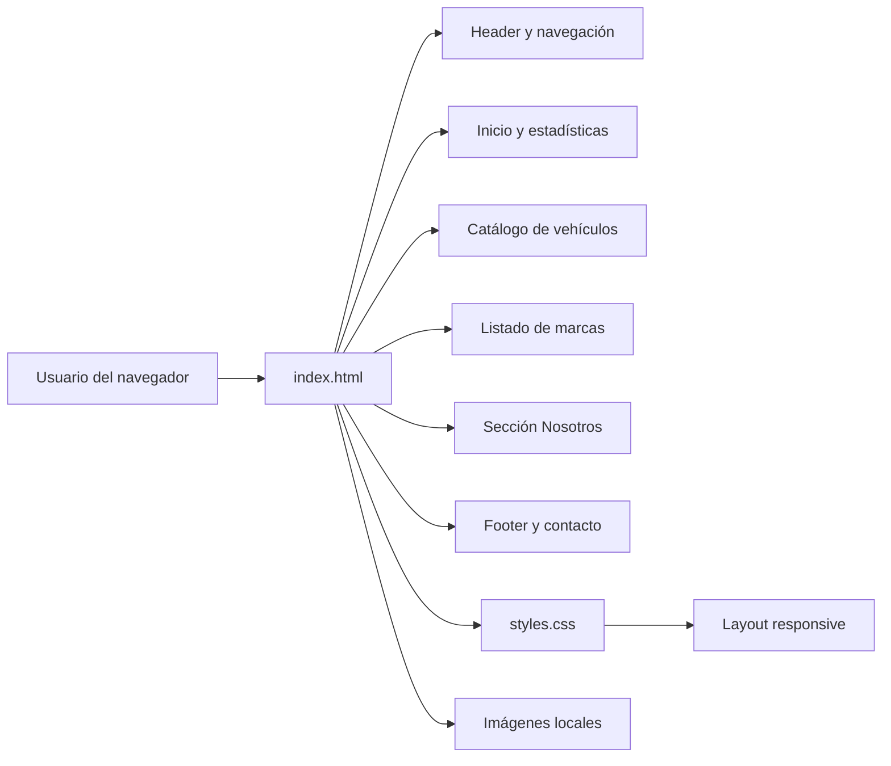
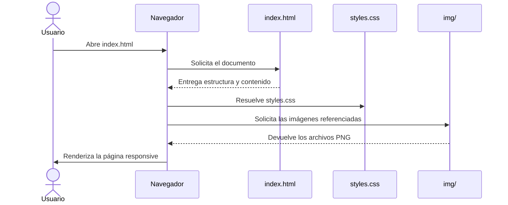
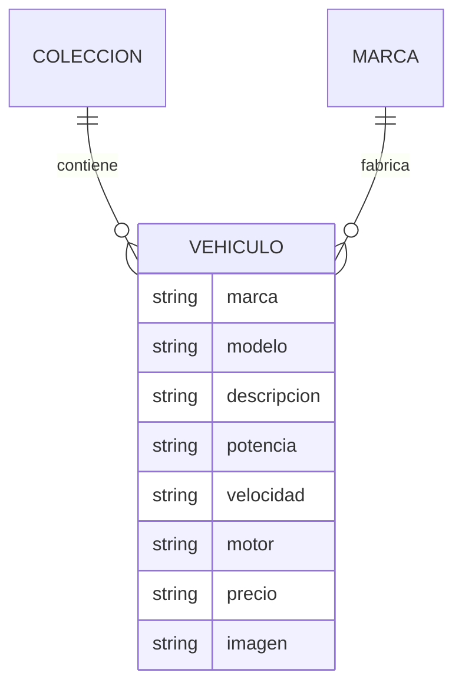

# Luxury Cars


Sitio web estático de presentación para Luxury Cars, dirigido a usuarios interesados en vehículos premium y de alto rendimiento. La página organiza una colección visual de automóviles, sus especificaciones principales y las marcas disponibles.

## Tabla de contenidos

- [Características principales](#características-principales)
- [Arquitectura](#arquitectura)
- [Stack tecnológico](#stack-tecnológico)
- [Estructura del proyecto](#estructura-del-proyecto)
- [Requisitos previos](#requisitos-previos)
- [Instalación y configuración](#instalación-y-configuración)
- [Uso](#uso)
- [Despliegue](#despliegue)
- [Información pendiente](#información-pendiente)

## Características principales

- Página de inicio con mensaje de marca, llamadas a la acción y navegación fija.
- Catálogo de nueve vehículos destacados.
- Ficha visual por vehículo con marca, modelo, descripción, potencia, velocidad máxima, motor y precio.
- Sección con ocho marcas representadas en la colección.
- Presentación de la filosofía y propuesta de experiencia de Luxury Cars.
- Información de contacto ubicada en el pie de página.
- Diseño adaptable para escritorio, tabletas y dispositivos móviles.

## Arquitectura

### Visión general y principios de diseño

El proyecto utiliza una arquitectura estática y monolítica. El documento HTML contiene tanto la estructura como el contenido, mientras que CSS define el diseño, la identidad visual, las animaciones y los puntos de adaptación responsive.

Las imágenes se sirven como recursos locales desde `img/`. No existe JavaScript, backend, API, sistema de sesiones ni base de datos en la implementación actual.

### Componentes del sitio



### Flujo de presentación principal



La navegación utiliza enlaces internos con fragmentos como `#inicio`, `#vehiculos`, `#marcas`, `#nosotros` y `#contacto`; el navegador desplaza la página hasta el elemento correspondiente.

### Modelo de contenido

El sitio no posee una capa de datos persistente. El contenido se encuentra modelado directamente en tarjetas HTML:



### Decisiones técnicas

| Decisión | Justificación observada |
| --- | --- |
| HTML y CSS sin frameworks | Mantiene el prototipo autocontenido, ligero y directamente ejecutable en un navegador. |
| Recursos gráficos locales | Las imágenes de vehículos se encuentran en `img/` y se referencian desde el HTML. |
| CSS responsive con media queries | Permite adaptar cuadrículas, navegación, tipografía y pie de página a distintos tamaños de pantalla. |
| Enlaces internos | La navegación principal funciona con fragmentos dentro de la misma página. |

### Consideraciones actuales

- **Seguridad:** al no existir backend, autenticación, formularios ni procesamiento de datos, no hay datos sensibles ni variables de entorno administradas por la aplicación.
- **Rendimiento:** el sitio depende de archivos locales. No se implementan optimización avanzada, caché, CDN ni carga diferida de imágenes.
- **Escalabilidad:** el catálogo está escrito directamente en HTML, por lo que cambios estructurados o grandes volúmenes de vehículos requerirían una fuente de datos y una plantilla dinámica.

## Stack tecnológico

| Tecnología | Versión | Rol |
| --- | --- | --- |
| HTML | 5 | Estructura semántica y contenido |
| CSS | 3 | Diseño visual, layout responsive y estados interactivos |
| PNG | - | Recursos gráficos locales de los vehículos |

No se encontró un archivo de manifiesto que declare versiones de dependencias o herramientas.

## Estructura del proyecto

```text
concesionario/
├── index.html      # Documento principal y contenido del sitio
├── styles.css      # Variables visuales, componentes, layout y responsive
├── README.md       # Documentación del proyecto
└── img/
    ├── aston.png
    ├── audi.png
    ├── BMW.png
    ├── ferrari.png
    ├── lambo.png
    ├── mclaren.png
    ├── mercedes.png
    ├── porsche.png
    └── wolkswagen.png
```

## Requisitos previos

- Navegador moderno.
- Git únicamente si se clona el repositorio.

No se requiere instalar Node.js, paquetes npm, Python ni un servidor de aplicaciones.

## Instalación y configuración

1. Clona el repositorio:

```bash
git clone https://github.com/Campriet03/concesionario-de-carros.git
```

2. Accede al directorio:

```bash
cd concesionario-de-carros
```

3. Abre el archivo principal en el navegador:

```text
index.html
```

También puede abrirse arrastrando `index.html` hacia una pestaña del navegador o mediante la opción de abrir archivo de VS Code.

El proyecto no requiere configuración adicional ni archivos de variables de entorno.

## Variables de entorno

No aplica. El proyecto no utiliza variables de entorno ni archivos `.env`.

## Uso

Al abrir `index.html`, la página presenta:

1. `Inicio`, con el hero principal y enlaces hacia el catálogo o la sección informativa.
2. `Vehículos`, con las fichas de Lamborghini, Ferrari, BMW, Mercedes-AMG, Porsche, Audi, McLaren, Aston Martin y Volkswagen.
3. `Marcas`, con las marcas incorporadas en la colección.
4. `Nosotros`, con la filosofía de Luxury Cars.
5. `Contacto`, con ubicación y datos de contacto.

Los enlaces de navegación utilizan secciones existentes dentro del mismo documento. Los enlaces sociales y los botones `Detalles →` están definidos con `href="#"`, por lo que actualmente no llevan a destinos externos o internos concretos.

## Despliegue

Al ser un sitio estático, puede desplegarse en cualquier servicio de alojamiento de archivos estáticos que conserve `index.html`, `styles.css` y la carpeta `img/`.

La publicación debe mantener las rutas relativas usadas por la página:

- `styles.css`
- `img/lambo.png`
- Y el resto de recursos incluidos en `img/`

No se encontró configuración de despliegue ni flujo de CI/CD en el repositorio.

## Autor
Camilo Prieto

## Información pendiente

- Definir y documentar una licencia.
- Definir destinos reales para los enlaces sociales.
- Implementar destinos funcionales para los botones `Detalles →`.
- Confirmar si los precios, potencias, velocidades y datos de catálogo corresponden a valores vigentes.
- Corregir la diferencia de mayúsculas en la referencia de BMW: el HTML usa `img/bmw.png`, mientras el archivo disponible es `img/BMW.png`.
- Verificar el nombre oficial del vehículo mostrado como Volkswagen, ya que el archivo disponible se llama `wolkswagen.png`.
